# H1 — Домашка 1

## 3 команды проверки

```bash
uv run pytest
```

```bash
docker build -t credit-score:1.0 .
docker compose up -d --build
```

```bash
kind create cluster --name credit-score 
kind load docker-image credit-score:1.0 --name credit-score 
kubectl apply -f k8s/ 
kubectl rollout status deploy/credit-score 
kubectl port-forward svc/credit-score 8000:80
```

## Тесты

Запустил командой `uv run pytest`, результат приложен в скрине ниже

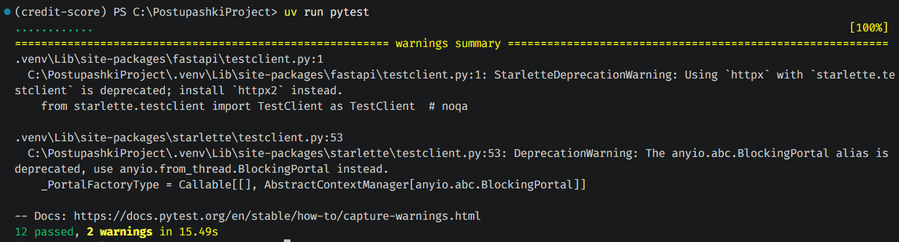

## Логи в базе данных

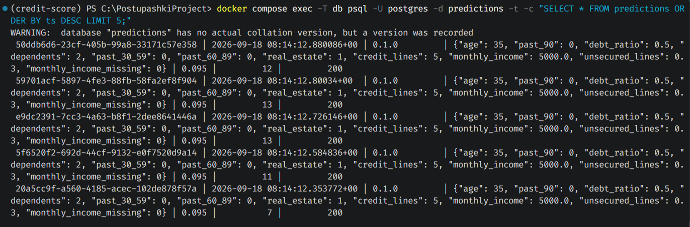

## Оркестрация в K8s

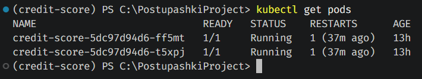

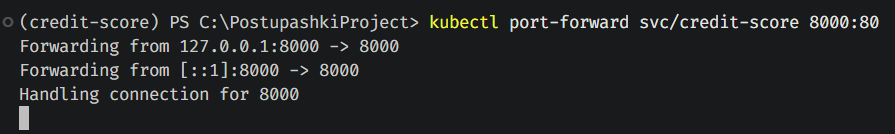

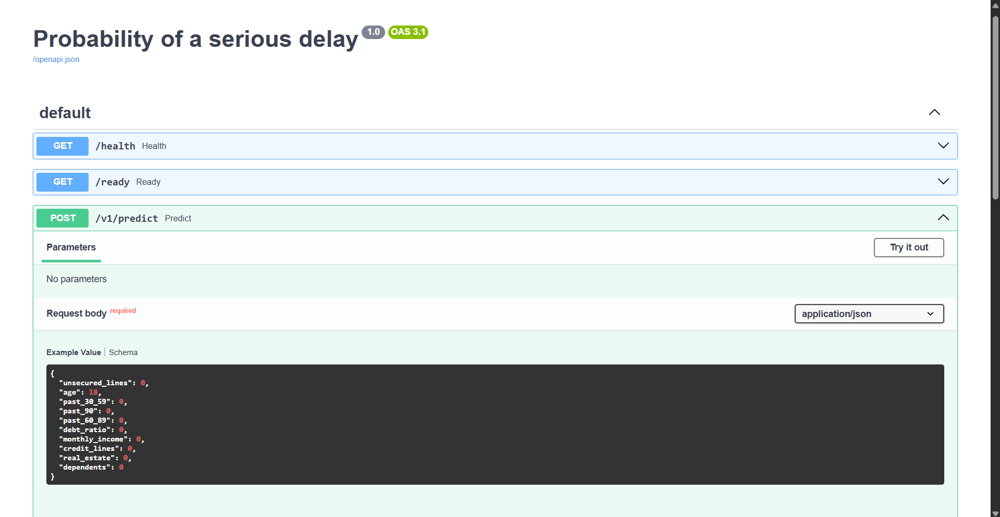

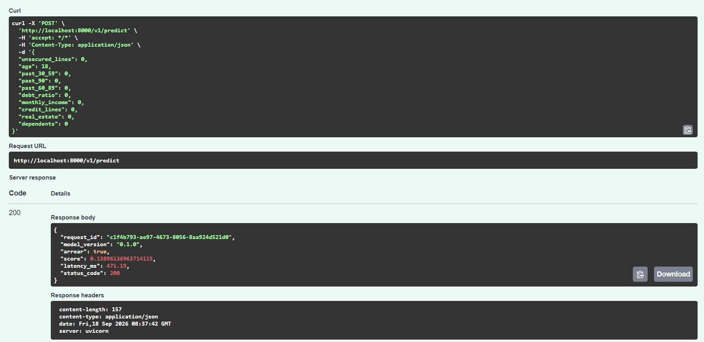

## Нагрузочное тестирование locust

-- run10.csv --

| Type             | RPS   | median | p95 | max    | errors |
| ---------------- | ----- | ------ | --- | ------ | ------ |
| GET /health      | 8.17  | 8      | 26  | 154.56 | 0      |
| POST /v1/predict | 22.00 | 19     | 49  | 240.03 | 0      |
| Aggregated       | 30.17 | 17     | 47  | 240.03 | 0      |

-- run50.csv --

| Type             | RPS   | median | p95 | max    | errors |
| ---------------- | ----- | ------ | --- | ------ | ------ |
| GET /health      | 22.32 | 130    | 390 | 626.36 | 0      |
| POST /v1/predict | 67.00 | 220    | 630 | 946.74 | 0      |
| Aggregated       | 89.33 | 200    | 590 | 946.74 | 0      |

-- run100.csv -- 

| Type             | RPS   | median | p95  | max     | errors |
| ---------------- | ----- | ------ | ---- | ------- | ------ |
| GET /health      | 21.06 | 480    | 900  | 1352.18 | 0      |
| POST /v1/predict | 64.54 | 890    | 1400 | 1860.69 | 0      |
| Aggregated       | 85.60 | 830    | 1300 | 1860.69 | 0      |

При 10 пользователях сервис работает с запасом: p95 (47 мс) отличается от медианы (17 мс) всего в ~2.8 раза, ошибок нет. 

Уже при переходе к 50 пользователям разрыв между p95 и медианой резко растёт (390 мс против 30 мс на 10 пользователях). Здесь начинается очередь на воркерах. 

При этом RPS почти не растёт при переходе от 50 к 100 пользователям (89.3 -> 85.6). Сервис уже упёрся ещё на 50 пользователях, а дальнейшая нагрузка лишь увеличивает время ожидания в очереди (медиана растёт с 200 до 830 мс), а не пропускную способность. 

Ошибок не было ни на одном из трёх прогонов, только растет время ожидания.

## Батч‐эндпоинт с замером

Для проверки написан скрипт scripts/measure_batch.py. Посчитана медиана из десятка повторов

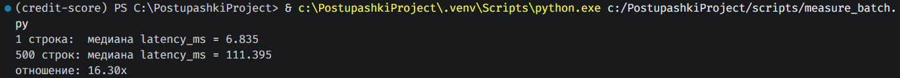

Медиана из 10 повторов: 1 строка = 6.835 мс, 500 строк = 111.395 мс. Батч из 500 строк дороже одиночного запроса всего в 16.3 раз, а не в 500. Причина в том, что sklearn считают предсказание для всей матрицы признаков одним векторизованным вызовом, а не строка за строкой.

## Выкат новой версии и откат

```
kubectl get deploy,svc,pods
kubectl get pods -w
kubectl set image deploy/credit-score api=credit-score:1.1
kubectl rollout status deploy/credit-score
kubectl rollout undo deploy/credit-score
kubectl rollout history deploy/credit-score
kubectl port-forward svc/credit-score 8000:80
```

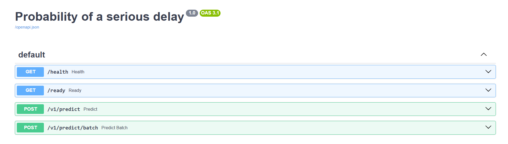

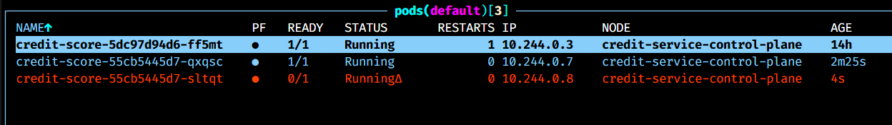

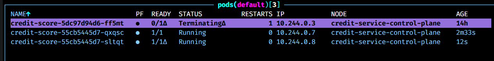

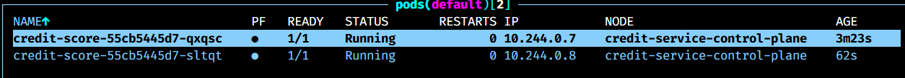

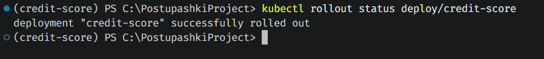
Версия FastAPI действительно поменялась

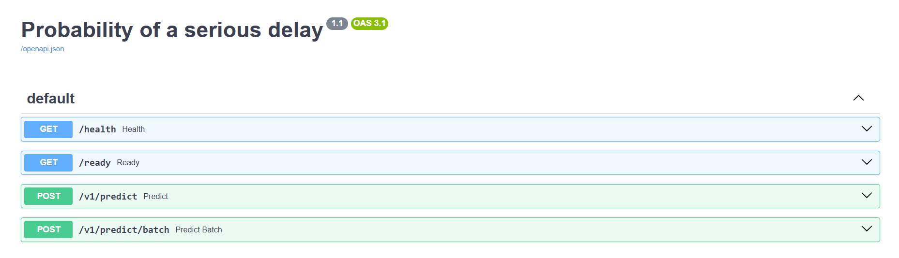

Откат по версии

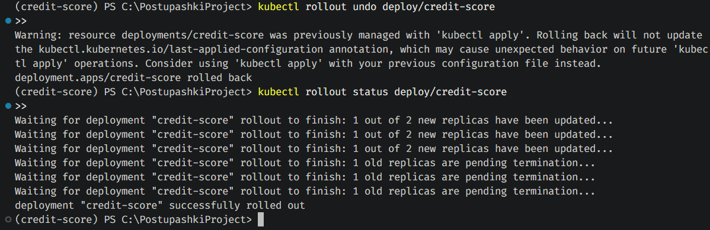

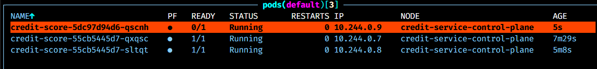

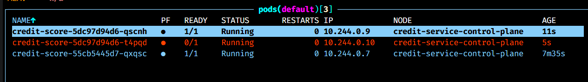

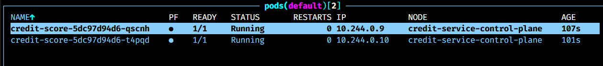

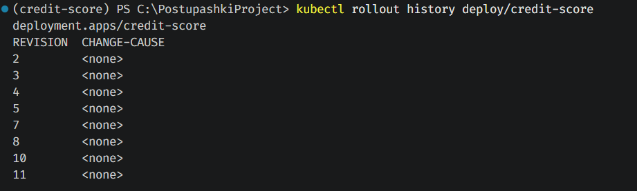

Опять пробросил порт, и версия FastAPI вернулась к 1.0

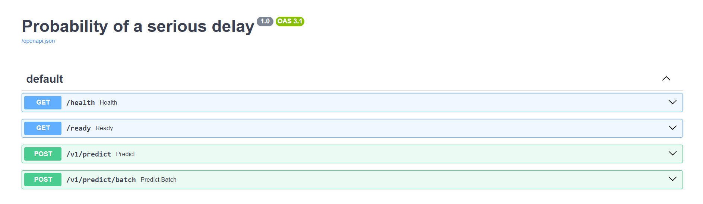

## Журнал проблем

Здесь скорее то, к каким архитектурным решениям я пришел. Не совсем уверен, что правильно их реализовал, поэтому был бы рад фидбеку.

В compose файле при инициализации БД я сделал подключение к ней через переменные окружения (хост, пароль, таблица и пользователь в .env файле). Но это немного усложнило тест работы БД. Для compose postgres лежит по хосту db, для docker файла и подов в k8s по localhost. Поэтому в .yml файле для compose хост задан напрямую (db), остальные параметры из окружения, а в остальных вариантах хост подтягивается из .env и подключается к локалке.

Выглядит немного как костыль, но мне хотелось, чтобы пароль к БД не был указан напрямую в yaml. В первой домашке я тогда не стал настраивать Secret в Kubernetes. Во второй домашке пароль передаётся через GitHub Secret `DB_PASSWORD`, а CI создаёт Kubernetes Secret `credit-secrets`, который Deployment подключает к контейнеру.

Логирование (не запись в БД, а в консольке через logger) только в app.py реализовано. Не совсем информативно

# H2 — Домашка 2: CI/CD

## Реализация пайплайна

На момент сдачи ДЗ 2 workflow `.github/workflows/ci.yml` запускал `tests` для pull request и push в `master`. Job `tests` поднимает PostgreSQL, запускает Ruff и pytest. На push в `master` после успешных тестов job `build` собирает Docker-образ и публикует его в GHCR с тегом по SHA коммита, а `deploy` создаёт кластер kind, разворачивает PostgreSQL и API, затем выполняет smoke test.

Пароль БД хранится в GitHub Secret `DB_PASSWORD`: workflow создаёт Kubernetes Secret `credit-secrets`, а Deployment импортирует его переменные через `secretRef`. Настройка `LOG_LEVEL` приходит из ConfigMap и возвращается в `/health`. После переделки в ConfigMap задано `DEBUG`, отличающееся от дефолта `INFO`; smoke проверяет именно `DEBUG`. Smoke test посылает реальные признаки, проверяет `0 <= score <= 1` и проверяет, что запрос записан в таблицу. При сбое диагностика собирает Pods, события, `describe` и логи, включая `--previous`.

## Таблица требований и доказательств

| Пункт | Результат | Доказательство |
|---|---|---|
| Три job: tests, build, deploy | Все три завершились успешно в run #20. | [Скриншот run #20](docs/img/hw2_memory_requests_green.jpg); [run #20](https://github.com/harut-prog/credit-score/actions/runs/36115476633) |
| GHCR-образ с тегом SHA | В run #20 использован `ghcr.io/harut-prog/credit-service:sha-7124af61c8c0eb3149055aeb5c471f043b196d3c`. | [Скриншот с тегом](docs/img/hw2_memory_requests_green.jpg); [страница пакета](https://github.com/harut-prog/credit-score/pkgs/container/credit-service); [build/deploy run #20](https://github.com/harut-prog/credit-score/actions/runs/36115476633) |
| Pull request: намеренно сломанный тест, затем исправление | Красная проверка показала `assert 200 == 201`; после исправления тесты прошли. На PR `build` и `deploy` ожидаемо пропущены. | [PR #3](https://github.com/harut-prog/credit-score/pull/3); [красный run #10, 60d2429](https://github.com/harut-prog/credit-score/actions/runs/36037799153); [зелёный run #11, f6d6389](https://github.com/harut-prog/credit-score/actions/runs/36039080294); [красная проверка](docs/img/hw2_broken_test.jpg), [ошибка assertion](docs/img/hw2_assertion_error_test.jpg), [зелёная проверка](docs/img/hw2_ci_all_green.jpg) |
| ConfigMap: неверный путь к модели | Run #13 упал при запуске API из-за отсутствующего файла; run #14 после исправления успешен. | [Красный run #13](https://github.com/harut-prog/credit-score/actions/runs/36041982811), [FileNotFoundError](docs/img/hw2_fake_joblib.jpg), [зелёный run #14](https://github.com/harut-prog/credit-score/actions/runs/36045651220) |
| Secret: имя `secretRef` не совпадает с именем созданного секрета | Run #15 упал на rollout; диагностика показала `CreateContainerConfigError`. Run #16 после исправления успешен. | [Красный run #15](https://github.com/harut-prog/credit-score/actions/runs/36110037031); [диагностика](docs/img/hw2_secret_ref_red.jpg), [зелёный run #16](https://github.com/harut-prog/credit-score/actions/runs/36110818433) |
| Ресурсы: запрос памяти не помещается на узле | В run #19 диагностика показала Pod в `Pending` и `FailedScheduling` из-за `Insufficient memory`; run #20 после возврата обычных значений успешен. | [Красный run #19 — rollout](https://github.com/harut-prog/credit-score/actions/runs/36114563278), [диагностика `Pending` / `Insufficient memory`](docs/img/hw2_failed_scheduling.jpg), [зелёный run #20](https://github.com/harut-prog/credit-score/actions/runs/36115476633) |
| Диагностика при сбое | Шаг `Diagnostics` собирает состояние Pods, события кластера и текущие/предыдущие логи контейнеров. | [Красный run #15](https://github.com/harut-prog/credit-score/actions/runs/36110037031) и [run #19](https://github.com/harut-prog/credit-score/actions/runs/36114563278); команды находятся в `.github/workflows/ci.yml` в шаге `Diagnostics`. |

## Переделки по фидбэку ДЗ 2

Описание выше и ответы о первоначальном deploy относятся к версии ДЗ 2. После ДЗ 3 deploy использует постоянный kind и self-hosted runner; в `fix_hw2` полный pipeline запускается по push в эту ветку, а на PR выполняются только tests.

- Исправлены PR #3 и ID красного прогона Secret; для red/green сценариев и финального run добавлены прямые ссылки Actions в таблице выше.
- Ответ 1 содержит факт о семи `CACHED` слоях и сравнение с первой сборкой; ответы 3 и 7 дополнены объяснением открытости ConfigMap и порядка отказов.
- `k8s/configmap.yaml` задаёт `LOG_LEVEL=DEBUG`, а `scripts/smoke_hw3.py` проверяет его через Ingress: дефолт `INFO` больше не маскирует отсутствие ConfigMap.
- `tests/test_integration.py` проверяет сохранённые `features->>'age'` и `model_version` успешного запроса. Smoke также сверяет оба поля с отправленным запросом и ответом API.
- Исправления выполняются в ветке `fix_hw2`; локально Ruff прошёл, pytest с отдельным PostgreSQL 17 завершился `18 passed` без skip (7 октября 2026). [PR #10](https://github.com/harut-prog/credit-score/pull/10), [полный прогон исправлений](https://github.com/harut-prog/credit-score/actions/runs/37667795585). Статус прогона проверяется по ссылке; deploy проверяет `DEBUG`, возраст и версию модели через Ingress и PostgreSQL.

## Семь вопросов

1. В build [run 36045651220](https://github.com/harut-prog/credit-score/actions/runs/36045651220) все семь слоёв помечены `CACHED`, включая `COPY src/` и `COPY artifacts/`: коммит менял только `configmap.yaml`, поэтому входы сборки не изменились. Для сравнения, первый build в [run 35528322370](https://github.com/harut-prog/credit-score/actions/runs/35528322370) занял 98 секунд: слои собирались заново. Кэширование здесь подтверждается логом, а не только разницей во времени.

2. Эти `ImagePullBackOff` Pods появляются при первоначальном применении `k8s/deployment.yaml`: там стоит шаблонный образ `credit-score:1.0`, которого нет в kind. Следом workflow выполняет `kubectl set image` на SHA-тег из GHCR; новые Pods запускаются, а временные Pods старого ReplicaSet удаляются. Поэтому само наличие переходных Pods в логе ещё не означает провал финального rollout.

3. Пароль задаётся в GitHub Secrets как `DB_PASSWORD`, workflow передаёт его в переменную окружения шага, а `kubectl create secret` сохраняет значение в Kubernetes Secret `credit-secrets` под ключом `POSTGRES_PASSWORD`. Deployment через `secretRef` передаёт этот ключ в контейнер как переменную окружения. В ConfigMap пароль хранить нельзя: файл `configmap.yaml` хранится в Git, а содержимое ConfigMap читается открытым текстом через `kubectl get cm -o yaml` пользователями с правом чтения этого ресурса. Secret также требует ограничения доступа; его не следует коммитить в Git.

4. Без `needs: tests` сборка может стартовать параллельно с тестами. Если тесты упадут, build всё равно способен опубликовать образ, а deploy — выкатить его на `master`, поскольку его зависимостью останется build; в результате непроверенная версия попадёт в кластер.

5. На pull request запускается только `tests`, потому что у jobs `build` и `deploy` стоит условие `if: github.ref == 'refs/heads/master'`. Для PR ref имеет вид `refs/pull/.../merge`, поэтому условие ложно. Это не даёт собирать и выкатывать образ из непроверенной ветки PR и не запускает deployment до слияния в `master`.

6. `pg_advisory_xact_lock(12345)` в `db.init()` сериализует инициализацию схемы и автоматически освобождается в конце транзакции. Без блокировки два API-pod могут одновременно начать создавать таблицу в пустой базе; при гонке одна инициализация может завершиться ошибкой, из-за которой соответствующий pod не поднимется. Речь о двух репликах приложения `credit-score`, а не о репликах PostgreSQL.

7. Порядок отказов по этапам запуска: **Pending → CreateContainerConfigError → CrashLoopBackOff**. При нехватке памяти планировщик не нашёл подходящий узел, поэтому Pod остаётся Pending. При неверном имени Secret Pod уже назначен узлу, но kubelet не может собрать окружение контейнера — CreateContainerConfigError. При неверном пути к модели процесс уже запустился, упал при загрузке модели и после повторных рестартов получил CrashLoopBackOff. Это порядок глубины прохождения запуска; в наших экспериментах каждую причину воспроизводили отдельно.

## Журнал проблем

1. **Тест в PR.** Я временно ожидал статус `201`, но endpoint вернул `200`: pytest показал `assert 200 == 201` и завершился с одним упавшим тестом. Исправил ожидаемый статус на фактический `200`, отправил следующий коммит и дождался зелёной проверки PR.

2. **Неверный путь к модели (runs #13 → #14).** В ConfigMap указал несуществующий путь. В `deploy` сломался rollout, а логи контейнера показали `FileNotFoundError` для `artifacts/no_baseline_be_sure.joblib` и `Application startup failed`. Исправил `MODEL_PATH` на существующий файл модели; следующий запуск завершил `tests`, `build` и `deploy` успешно.

3. **Неверное имя Secret (runs #15 → #16).** Workflow создаёт `credit-secrets`, а в `secretRef` временно было указано `credit-secret`. `Deploy API` не дождался rollout; диагностика показала Pod в `CreateContainerConfigError`. Вернул точное имя `credit-secrets`; следующий run прошёл.

4. **Недоступная память (runs #19 → #20).** Первая попытка с огромным `requests.memory` при `limits.memory: 1Gi` была отклонена Kubernetes API ещё при `kubectl apply`, потому что request превышал limit. Для повторной симуляции я сделал request и limit одинаково большими: манифест применился, rollout завершился таймаутом, а диагностика подтвердила Pod `Pending` и `FailedScheduling` с причиной `Insufficient memory`. Затем вернул `requests.memory: 512Mi` и `limits.memory: 1Gi`; run #20 прошёл все три job.

5. **Контролируемые deploy в HW3.** Базовый green: [bea7735 / run 37053723403](https://github.com/harut-prog/credit-score/actions/runs/37053723403). Неверный Registry alias: [red 08ebda0 / run 37054105773](https://github.com/harut-prog/credit-score/actions/runs/37054105773) → [fb3a465 / run 37054829281](https://github.com/harut-prog/credit-score/actions/runs/37054829281). Во втором прогоне `tests` и `build` прошли, но **deploy остался красным: упал smoke**. Лог MLflow при первом отказе сообщил `Registered model alias no-such-alias not found`; возврат `champion` исправил alias, но не сделал весь run зелёным. Полный успешный deploy позже подтверждён [run 37137311586](https://github.com/harut-prog/credit-score/actions/runs/37137311586).

6. **Неверное имя kind-кластера.** [red 5023388 / run 37055871329](https://github.com/harut-prog/credit-score/actions/runs/37055871329) → [green eaa2ba0 / run 37137311586](https://github.com/harut-prog/credit-score/actions/runs/37137311586). `tests` и `build` прошли, а deploy остановился на `Select existing kind cluster`: `could not locate any control plane nodes for cluster named 'credit-service-missing'`. Исправление env на `credit-service` вернуло доступ к существующему кластеру.

7. **Неверный Ingress host.** [red 42ec761 / run 37137683401](https://github.com/harut-prog/credit-score/actions/runs/37137683401) → [green 3c78e59 / run 37137910217](https://github.com/harut-prog/credit-score/actions/runs/37137910217). Rollout был успешен, но smoke на `/health` получил `HTTP Error 404: Not Found`, потому что запрос шёл с Host `credit.localhost`, а правило временно слушало `wrong-credit.localhost`. Возврат host `credit.localhost` восстановил полный smoke, включая проверку записи в PostgreSQL.

Для исправленных сценариев я сохранял отдельные коммиты: `f3ecaa2` — модель, `6eea4da` — Secret, `7124af6` — память. Первоначальную ошибочную попытку с request больше limit оставил в истории как диагностический шаг, а в отчёте основным ресурсным сценарием указал повтор run #19.

# H3 — Домашка 3: MLOps

## Что запущено и как это проверено

### Скриншоты HW3

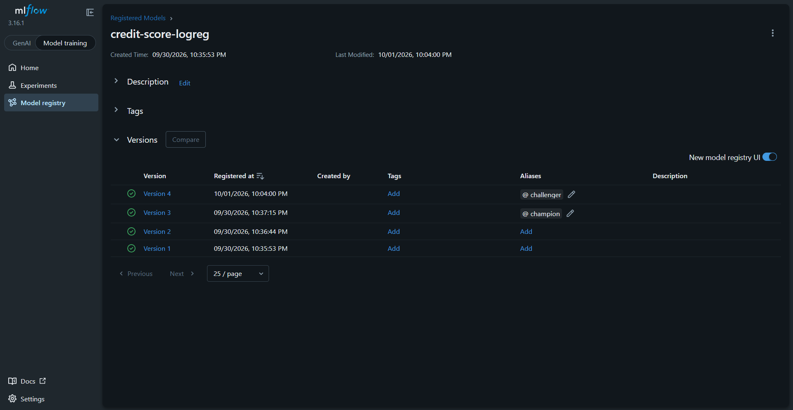

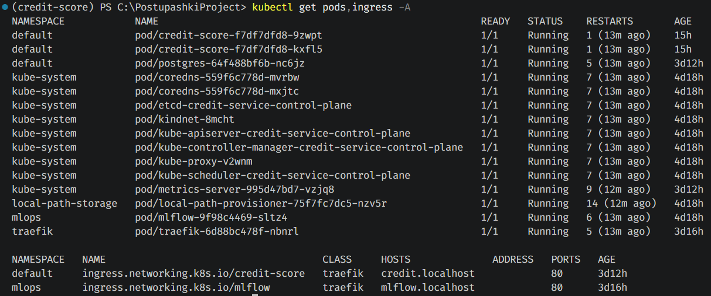

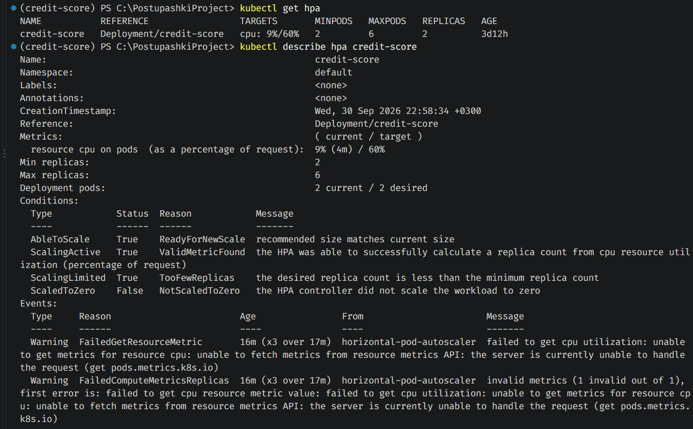

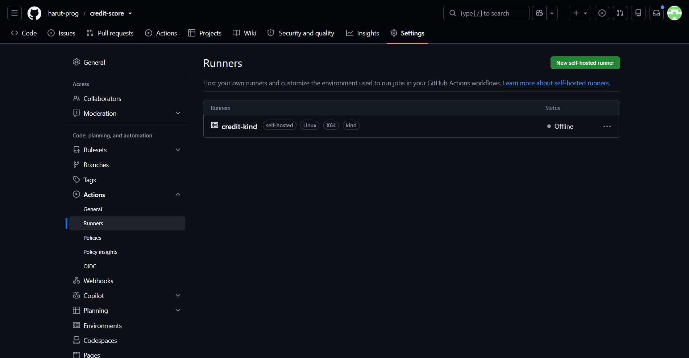

Исторические события HPA подтверждены снимком ниже. На нём видны переходы с 2 на 4 и с 4 на 6 реплик.

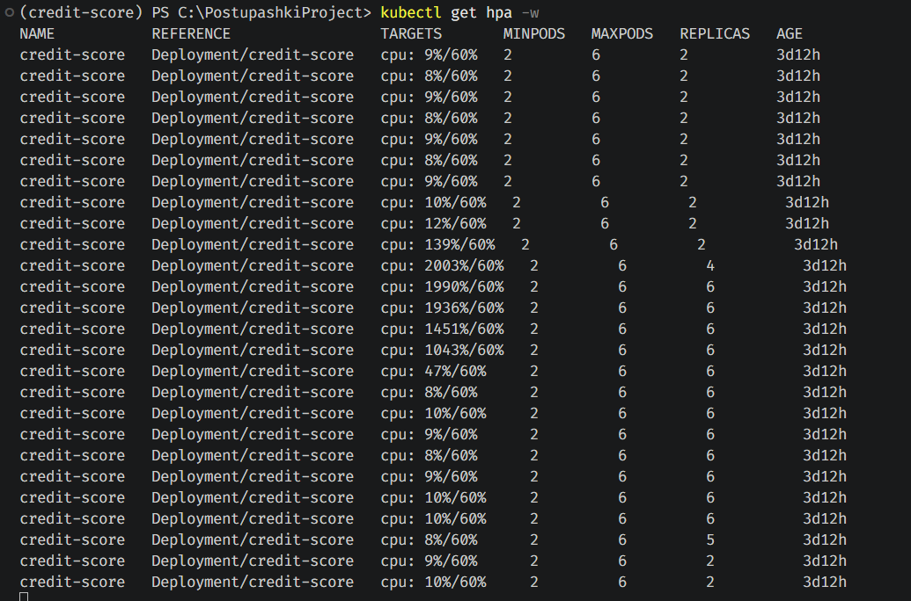

Итог наблюдения за HPA — ниже: во время нагрузки число реплик выросло до 6, после остановки нагрузки вернулось к 2.

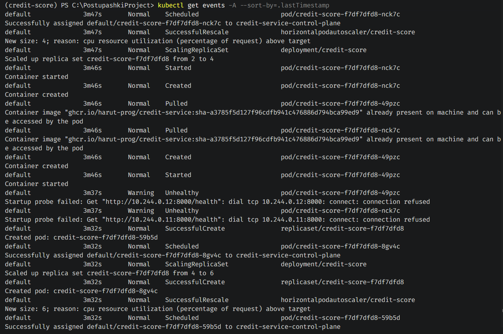

Текстовый журнал находится в `report/hpa/hpa30-cluster.txt`, результаты Locust — в `report/hpa/hpa30_*.csv`.

Кластер kind `credit-service` создан с пробросом localhost:80 на NodePort 30080. Traefik направляет `mlflow.localhost` в MLflow, а `credit.localhost` в API. На момент проверки в кластере были готовы MLflow, Traefik, metrics-server, PostgreSQL и две реплики API. HPA установлен с границами 2–6 и порогом 60% CPU. API загружает из Model Registry алиас `champion`, а `/health` сообщает фактическую версию и `run_id`.

Проверка `scripts/smoke_hw3.py` через Ingress вернула `model_source=registry`, `model_version=3`, `score=0.4401357943582565`, `status_code=200`. Запрос с ID `e87965ad-b002-4592-a2b3-26f6225536ec` найден в PostgreSQL с теми же score и версией. Публичная сводка — [report/evidence.md](report/evidence.md).

Локальная проверка кода: `ruff check .` прошла, fallback тесты дали 15 passed и 3 skipped без БД; после запуска Compose PostgreSQL три интеграционных теста `-m integrations` прошли. Они проверяют записи для статусов 200, 422 и 500.

| Требование | Факт и доказательство |
|---|---|
| MLflow/Ingress | `mlflow.localhost` открывается в разделе Model training; Registry содержит `credit-score-logreg` версии 1–4. `kubectl get pods,ingress -A` и конфигурация — в `platform/` и `k8s/`. |
| Три запуска и гейт | Логи `report/train/train{1,2,3}.txt`; [сводка](report/evidence.md). AP на одном validation split: 0.374676525 → 0.369516914 → 0.376070321. Версия 2 отклонена; `champion=3`. Сохраняются параметры, метрики, PR curve, metadata и `data_md5`. |
| Registry и API | `/health` показывает `champion=3`; smoke проверил версию, ответ и точную запись в БД. Loader валидирует состав признаков и threshold, ошибка Registry не маскируется fallback файлом. |
| Git/DVC | V1: `cce525a1d41f234f58d3bb52f3d2516b` (150000 строк); V2: `d7123f735b51ec6675c136a2a944aa25` (149730 строк). [Трансформация](report/data-v2.txt), [DVC push](report/dvc-push-v2.txt), [проверка чистого клона](report/evidence.md), Git V2 `7d56f4e2fe269d88175d7d0e31c4f739edaf6fe4`. `dvc diff 9e2df3a 7d56f4e` показал один изменённый CSV. |
| HPA и нагрузка | [Публичная таблица измерений](report/evidence.md). CSV и снимки HPA сохранены в [report/hpa](report/hpa). |
| Локальный runner и CI | Runner `credit-kind` зарегистрирован для `harut-prog/credit-score`, в сети Docker `kind`; из контейнера доступны `kind`, `kubectl` и узел `credit-service-control-plane`. Workflow применяет Secret, PVC, API и HPA, затем выполняет smoke через Ingress. |

## Обучение и выбор champion

Модель — `Pipeline` с `ColumnTransformer`, пропуски `monthly_income` и `dependents` заполняются внутри pipeline. `add_indicator=True` для дохода создаёт индикатор пропуска в обучении и инференсе одинаково. Строки с кодами 96/98 и нулевым возрастом исключены перед разбиением; исходная маска заключена в скобки, удалено 270 строк. Гейт сравнивает Average Precision кандидата и действующего champion на **одном и том же** validation split и требует улучшения хотя бы на `MIN_GAIN=0.001`. Каждая версия получает `challenger`; `champion` меняется только при прохождении гейта. Выход `train.py` сохраняет номера версий и решение.

Запуск на V2 данных создал Registry version 4, `data_md5=d7123f735b51ec6675c136a2a944aa25` и не повысил champion: после удаления уже отфильтрованных при обучении записей validation AP осталась 0.376070321. Это отдельная версия сырого файла; обучающие строки совпали. У MLflow на Windows при перенаправлении вывода в кодировке cp1251 дополнительно возникал `UnicodeEncodeError` при печати emoji в ссылке на run. Регистрация и финальное JSON-решение завершились, но для чистого лога следующего запуска установлена `PYTHONIOENCODING=utf-8`.

Откат проверен через UI Registry: `champion` перенесён с версии 3 на 1, затем выполнен `kubectl rollout restart deploy/credit-score`. Полный rollout шести реплик занял **21,64 с**; `/health` после него показал `model_version=1`, `run_id=17db9ff516254503b7dced238feff4ab`. Образ до и после был тем же `credit-score:hw3`. Затем через UI `champion` возвращён версии 3, Deployment перезапущен; `/health` снова показал `model_version=3`, `run_id=72327f8482c6423d90815ca32aed949b`. Сразу после второго `rollout status` один запрос Ingress кратко вернул 502; повтор через четыре секунды прошёл. Поэтому для оценки доступности одного `rollout status` недостаточно — нужен фактический HTTP smoke после обновления endpoints.

## HPA и три прогона

Первый прогон при 10 пользователях и CPU request 250m: 7108 запросов, ошибок нет, суммарно 29.77 RPS, p95 `/v1/predict` 83 мс. CPU было около 2% от request, HPA держал две реплики. После этого request CPU уменьшен до 50m в `k8s/deployment.yaml`, чтобы на том же учебном узле увидеть реакцию порога 60%; лимит остался 1 CPU на Pod.

При 30 пользователях HPA выдал `SuccessfulRescale` сначала до 4, затем до 6 реплик. Во время прогона `kubectl top pods` показывал 798–989m CPU и 191–196Mi памяти на Pod, HPA — 1745%/60%. Locust выполнил 11812 запросов, из них один POST получил 502 во время масштабирования; p95 POST 790 мс, суммарно 65.86 RPS. Поэтому здесь нельзя утверждать нулевую долю ошибок: она равна 1/11812 ≈ 0.0085%.

При 60 пользователях HPA оставался на максимуме 6 реплик. CPU был 561–1001m на Pod, память 193–199Mi, HPA — 1349%/60%. Locust выполнил 20120 запросов, из них три POST получили HTTP 502; суммарно 111.92 RPS, p95 POST 1400 мс. Рост RPS по сравнению с 30 пользователями сопровождается ростом задержки и ненулевой долей ошибок 3/20120 ≈ 0.015%. Это предел учебного однопроцессорного кластера/Ingress, а не гарантия отсутствия ошибок при масштабировании.

После остановки 60 пользователей в 22:11:29 MSK HPA вернулся к двум репликам в 22:19:50 — через **8 мин 21 с**. Покадровый журнал — `report/hpa/hpa-scale-down.txt`. Внутри этого интервала я дважды перезапускал Deployment для проверки отката модели; HPA сообщил `ScaleDownStabilized` и краткие ошибки получения метрик от ещё не готовых Pod. Поэтому 8 мин 21 с — наблюдаемое время в этой последовательности, а не чистая оценка стандартного окна стабилизации HPA.

| Пользователи | CPU request | Реплики | RPS всего | p95 POST | Ошибки |
|---:|---:|---:|---:|---:|---:|
| 10 | 250m | 2 | 29.77 | 83 мс | 0 / 7108 |
| 30 | 50m | 2 → 4 → 6 | 65.86 | 790 мс | 1 / 11812 |
| 60 | 50m | 6 (максимум) | 111.92 | 1400 мс | 3 / 20120 |

## Восемь вопросов

1. `tests` и `build` выполняются на GitHub-hosted runner: им нужны исходники, зависимости и право публикации образа, но не локальный Kubernetes. `deploy` выполняется на self-hosted runner в Docker рядом с kind, поскольку кластер за домашним NAT и не имеет публичного API. Альтернативы — VPN/tunnel с контролем доступа или внешний кластер; открывать Kubernetes API в интернет ради домашней работы не нужно.

2. Сеть Docker `kind` даёт runner доступ к адресу control-plane и Ingress из контейнера. Docker socket нужен для `kind export kubeconfig`, `docker pull` и `kind load docker-image`; группа `0` даёт непривилегированному пользователю runner доступ к этому сокету. Такой доступ практически эквивалентен управлению Docker-host, поэтому runner выделен только под доверенный репозиторий, а внешние PR должны требовать одобрения до исполнения на нём.

3. Workflow получает `DB_PASSWORD` из GitHub Secret только в окружение шага. `kubectl create secret --dry-run=client -o yaml | kubectl apply -f -` создаёт или обновляет один Kubernetes Secret повторяемо: dry-run готовит объект, apply отправляет его в кластер. Пароль не записывается в Git и не печатается в логах; Deployment и PostgreSQL получают его через `secretRef`/`secretKeyRef`.

4. `challenger` указывает на последнюю проверяемую версию, `champion` — на прошедшую порог качества. Алиас сохраняет стабильное имя для сервиса, а номер версии даёт точное воспроизведение. Перенос `champion` с версии 3 на 1 и restart Pod откатывает модель без нового образа; `kubectl rollout undo` откатывает Kubernetes Deployment (например, код/образ), но само по себе не меняет Registry alias.

5. До первого обучения Registry ещё не содержит `champion`. Под с `MODEL_NAME` не может загрузить модель и не должен сообщать Ready; при таком порядке развёртывания CI завершится ошибкой rollout, а в логах будет ошибка поиска alias. Поэтому сначала запуск обучения и проверка champion в MLflow, затем API/runner. Состояние видно через `kubectl get pods` или k9s и шаг Diagnostics в GitHub Actions.

6. Браузер обращается к localhost:80 с Host `mlflow.localhost`. Порт 80 проброшен при создании kind на NodePort 30080; Traefik Ingress выбирает `mlflow` Service по Host, Service ведёт на Pod:5000. Для API аналогично используется Host `credit.localhost`. В MLflow отдельно разрешены нужные host/origin настройки; одно лишь создание Ingress не исправляет отказ приложения из-за проверки Host/CORS.

7. HPA считает утилизацию как используемый CPU / `requests.cpu` и приблизительно рекомендует `ceil(текущие реплики × текущая утилизация / 60%)`, с ограничением 2–6. При 250m и малой нагрузке около 2% было недостаточно для роста; при 50m и 30 пользователях наблюдалось 1745%, поэтому целевое число упёрлось в максимум 6. Спад происходит с задержкой стабилизации HPA, а не сразу после остановки Locust; точное время зафиксировано отдельно ниже.

8. Git хранит код и маленький указатель `.dvc`, DVC remote — содержимое большого CSV. Для восстановления данных конкретного run берём `git_sha` и `data_md5` из MLflow, переключаем Git на этот SHA, выполняем `dvc pull` или `dvc checkout` и сравниваем MD5 файла. Версия модели в Registry связана с `run_id`, поэтому путь Registry version → run → Git/DVC однозначен, если remote сохранён.

## Журнал проблем ДЗ 3

- В первых трёх вызовах обучения загрузчик skops не доверял `numpy.dtype`; затем Windows cp1251 ломал печать ссылки MLflow, а системный proxy мешал `.localhost`. После исправлений три запуска завершились и дали решения гейта; старые логи оставлены для разбора ошибки, рабочие имеют суффикс `-fixed`.
- При 30 пользователях во время роста реплик Ingress один раз вернул 502. Дальше сравниваю с прогоном 60 пользователей и проверяю, повторяется ли отказ.
- Local DVC remote `C:\dvc-storage` подходит для соседнего клона на этом компьютере, но не переносится на другую машину без копирования storage или смены remote. Это явно указано в README.

# H4 — Итоговый проект (работа в ветке `hw4`)

## Состояние и границы доказательств

Работа собрана на базе HW3 в ветке `hw4` и вынесена в [черновик PR #11](https://github.com/harut-prog/credit-score/pull/11) в `master`. 14 октября опубликованы [основная реализация `30ffa1b4489f4d79a7568d3a8bed8ff99a8202e2`](https://github.com/harut-prog/credit-score/commit/30ffa1b4489f4d79a7568d3a8bed8ff99a8202e2), [плохая DVC-версия `fbe11c8b27d21e791d79373bbfb6141491696f08`](https://github.com/harut-prog/credit-score/commit/fbe11c8b27d21e791d79373bbfb6141491696f08) и [её отмена `18055945772d546a44cfd619e32c3b65d66c7740`](https://github.com/harut-prog/credit-score/commit/18055945772d546a44cfd619e32c3b65d66c7740). Все три commit URL и соответствие полных SHA проверены по GitHub API. [Run 38558848380](https://github.com/harut-prog/credit-score/actions/runs/38558848380), [run 38560231248](https://github.com/harut-prog/credit-score/actions/runs/38560231248) и [run 38561571900](https://github.com/harut-prog/credit-score/actions/runs/38561571900) завершились `success` во всех трёх jobs; красный исход плохих данных находится в Airflow DAG, а не в CI deploy. [Последний push run 38566192268](https://github.com/harut-prog/credit-score/actions/runs/38566192268) прошёл tests, build и deploy; [run PR 38568265428](https://github.com/harut-prog/credit-score/actions/runs/38568265428) прошёл tests, а build и deploy пропущены по условию workflow. PR, все пять коммитов и результаты проверок сверены на странице GitHub. Старые ссылки на 17 Actions run из разделов HW2/HW3 проверены по GitHub API 13 октября; найдено и исправлено одно неверное слово «green» у `37054829281` — run завершился `failure` на smoke.

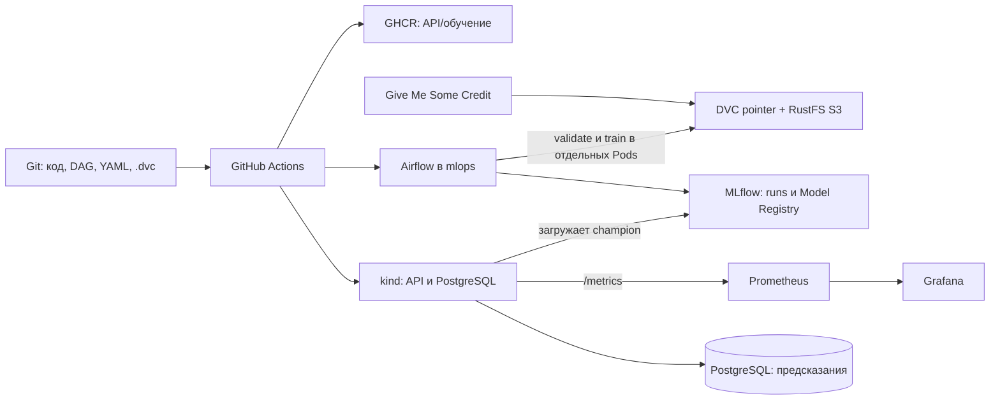

| Объект | Где хранится | Как найти версию |
|---|---|---|
| Код, DAG, манифесты | GitHub / Git | полные SHA коммитов в PR #11; сценарий плохих данных показан коммитом `fbe11c8…` и отменой `1805594…` |
| CSV | RustFS, бакет `dvc`, объект DVC | `data/credit_score.csv.dvc` в Git, `data_md5` в MLflow |
| Модель и метаданные | MLflow Model Registry и артефакты run | `credit-score-logreg` + version/alias, `run_id`, `metadata.json` |
| Образ | GHCR после CI; локально `credit-score:hw4-clean` для проверки | тег `sha-<полный SHA>` опубликованного коммита |
| Логи запросов | таблица `predictions` PostgreSQL | `request_id`, `model_version`, время, статус |
| Метрики | Prometheus (retention 2d) | имя метрики и labels `service`, `pod`, `model_version` |

## Пункт задания → доказательство

| Пункт | Файл / проверка | Состояние 14.10 |
|---|---|---|
| Платформа одной командой | `platform/up.sh`, `platform/airflow.yaml`, `platform/s3.yaml`, `platform/monitoring-values.yaml`; `kubectl get pods -A` показал Running для API, PostgreSQL, Airflow, MLflow, RustFS, Prometheus, Grafana | повтор из чистого клона прошёл на существующем kind, включая Helm, rollout и бакет; отдельный пустой кластер не создавался |
| DVC и S3 | `.dvc/config`, `scripts/bootstrap_data.py`, `.dockerignore`, Dockerfile; `dvc push -r laptop` через port-forward; SHA256 источника и MD5 результата сверены | корректный и временно испорченный объекты загружены в бакет. 14 октября основной Dockerfile собран в `credit-score:hw4-clean`; проверено, что внутри есть `.dvc`-указатель и нет CSV, модули API и обучения импортируются. |
| Pandera | `src/credit/data.py`, `tests/test_data.py`; локальный запуск `22 passed` с PostgreSQL; [зелёный validate](http://mlflow.localhost/#/experiments/2/runs/b08365ed55df421692c01a9addcebc30), [красный validate](http://mlflow.localhost/#/experiments/2/runs/ed652f925d614e259a2a5b87f6d85e3e) | у красного run `FAILED`, `valid=false`, артефакт `failure_cases.csv`, код 1; зелёный run: 149730 строк |
| Метрики и Grafana | `src/credit/service/app.py`, `platform/service-monitor.yaml`, `platform/dashboard.yaml`, `scripts/traffic.py`, `k8s/deployment.yaml`; [Prometheus up](report/hw4/prometheus-up.json), [версии v6 по Pod](report/hw4/model-version-by-pod.json), [трафик при rollout v3→v6](report/hw4/promotion-traffic.txt), [smoke champion v9](report/hw4/reproducible-champion-smoke.json) | Prometheus `up=1`; после rollout v6 метрика `credit_model_info{model_version="6"}` была на шести Pod. Текущий smoke проверил метрику версии 9; [dashboard](http://grafana.localhost/d/credit-hw4/credit-score-service) отдан Grafana API. При переключении v3→v6 было 484 запроса, 0 ошибок. Скриншот dashboard пока отсутствует. |
| Airflow | `dags/credit_retrain.py`; [локальные прогоны](report/hw4/dag-runs.json), [отказ гейта](report/hw4/rejected-run-tasks.json), [promotion](report/hw4/promoted-run-tasks.json), [плохие данные из SHA-образа](report/hw4/bad-data-committed-run-tasks.json), [MLflow отказ](report/hw4/bad-data-committed-mlflow.json), [восстановление на SHA-образе](report/hw4/recovered-committed-run-tasks.json), [воспроизводимый champion](report/hw4/reproducible-champion-run-tasks.json) | гейт отклонил challenger, улучшенная модель стала champion v6 и вызвала rollout; образ `fbe11c8…` с плохими данными остановил validate, train и rollout не запустились; образ revert `1805594…` прошёл validate/train. Отдельный запуск на опубликованном SHA дал текущий champion v9. |
| CI/CD | `.github/workflows/ci.yml`: tests → build → deploy; публикация DAG, dashboard и переменных; smoke проверяет Registry, ответ, PostgreSQL и `credit_model_info`; [локальный smoke полного образа](report/hw4/clean-image-smoke.json), [run основного SHA](report/hw4/ci-main-run.json), [run плохих данных](report/hw4/ci-bad-data-run.json), [run после revert](report/hw4/ci-restored-run.json) | [Последний push run](https://github.com/harut-prog/credit-score/actions/runs/38566192268) завершился `success` во всех трёх jobs; deploy выполнил runner `credit-kind`. Текущий smoke проверил champion v9, запрос, PostgreSQL и метрику. [Проверка PR](https://github.com/harut-prog/credit-score/actions/runs/38568265428) прошла tests; build и deploy на PR пропущены по условию workflow. |
| Quickstart | `README.md`: clone, платформа, восстановление исходного DVC CSV, push, champion, образ, API, Ingress, DAG; [smoke из чистого checkout](report/hw4/fresh-clone-smoke.json) | чистый clone `hw4` на SHA `1805594…`: `uv sync --frozen`, `platform/up.sh`, `dvc pull -r laptop`, сверка MD5 и smoke через Ingress прошли. Использован существующий kind с PVC; полное создание нового кластера не проверялось, чтобы не удалять рабочие данные. |

**Пороговые значения схемы.** После очистки в исходной версии 149730 строк, доля просрочки 6.598%, медиана `monthly_income` 5400. Ограничения `EXPORT` — не меньше 140000 строк, 5–8% просрочки и медиана дохода 4000–7000: допускают умеренное изменение выгрузки и ловят обрезанный или существенно смещённый файл. Возраст 18–120 согласован с Pydantic API; 13 исходных клиентов старше 100 остаются в обучении. `96`/`98` в трёх счётчиках просрочек и возраст 0 удаляются перед проверкой.

**Buckets задержки.** В прежнем замере для `/v1/predict` у 10 пользователей медиана была 19 мс, p95 — 49 мс (`report/locust/run10_stats.csv`). Поэтому histogram API чаще разбит около 15–50 мс: 5, 10, 15, 20, 30, 40, 50, 80, 100, 250, 500 и 1000 мс. Уникальные `request_id` и значения признаков в labels отсутствуют.

## Сценарии переобучения

`credit_retrain` выполняет `validate → train → promoted → rollout`. Validate и train — разные Kubernetes Pods из образа API; каждый сначала делает `dvc pull -r cluster`. `train` записывает JSON решения гейта в `/airflow/xcom/return.json`; `promoted` проверяет поле `promoted`, а rollout перезапускает `deployment/credit-score` только после истинного решения. Оба образа для локальной проверки собраны поверх заранее закешированного `credit-score:hw4` с актуальными `src` и DVC-указателем; исходный CSV в образ не копировался. У этих проверочных образов нет Git SHA коммита.

| Сценарий | DAG run UTC | Результат |
|---|---|---|
| Гейт отклоняет | `manual__2026-10-13T17:22:56.010946+00:00` | `validate`, `train`, `promoted` успешны, `rollout` пропущен. Challenger v5, run `5fae35e740574cb3a9c61e50ef4adae2`: AP 0.3695169 против champion v3 AP 0.3760703. |
| Модель лучше | `manual__2026-10-13T17:29:54.948615+00:00` | Все четыре задачи успешны. Вариант `quantile` дал AP 0.3977666609404553 против 0.3760703210620944; champion v3 → v6, run `82b8b8495cc14da9b0fcec79af70cae2`. `kubectl rollout status` успешен, `/health` вернул v6. За 120 с трафика: 484 запроса, 0 ошибок, 437 ответов v3 и 47 v6; Prometheus затем увидел v6 на шести Pod. |
| Данные испорчены | `manual__2026-10-13T17:38:09.849538+00:00` | В первой строке age 45 → 121, DVC MD5 `d7dd0989a975e8fade620adf89d6a549`, объект загружен в RustFS, отдельный проверочный образ содержит его указатель. `validate=failed`, три следующие задачи `upstream_failed`, DAG красный. MLflow validate run [602e038072c645849406b1ebcc796e66](http://mlflow.localhost/#/experiments/2/runs/602e038072c645849406b1ebcc796e66) имеет `FAILED`, `valid=false` и артефакт `failure_cases.csv`; API продолжил отдавать champion v6. |
| Восстановление | `manual__2026-10-13T17:40:20.097969+00:00` | Исходный CSV и указатель MD5 `d7123f735b51ec6675c136a2a944aa25` возвращены, Airflow снова использует рабочий образ. Validate/train прошли, гейт отклонил нового challenger, rollout пропущен; DAG успешен, champion v6 сохранён. |
| Воспроизводимый champion | `manual__2026-10-14T12:41:30.572797+00:00` | На опубликованном образе SHA `08ea3c0…` вариант `C=3`, `quantile`, `balanced` дал AP 0.3977678400 против v6 AP 0.3977666609. Для обслуживания происхождения модели временно установлен `MIN_GAIN=0`; все четыре задачи и rollout прошли, champion v9. Прирост всего 0.000001179, поэтому он не предъявляется как существенное улучшение качества. Обычный порог `0.001` и `C=1` после прогона возвращены. [Метаданные MLflow](report/hw4/reproducible-champion-mlflow.json), [smoke](report/hw4/reproducible-champion-smoke.json). |

14 октября формальный сценарий повторён на опубликованном SHA-образе. Коммит `fbe11c8…` изменил только DVC-указатель после проверки `dvc push -r laptop`. Его CI успешно развернул `ghcr.io/harut-prog/credit-service:sha-fbe11c8b27d21e791d79373bbfb6141491696f08` и выставил ту же ссылку в Airflow Variable `credit_image`. DAG run `manual__2026-10-14T12:06:00.617204+00:00`: `validate=failed`, остальные три задачи `upstream_failed`; [MLflow run `e14e65169c964660a3e5e708a0cc02f1`](http://mlflow.localhost/#/experiments/2/runs/e14e65169c964660a3e5e708a0cc02f1) имеет `FAILED`, `valid=false`, `failure_cases.csv`. `/health` после отказа продолжал возвращать champion v6. Отдельный revert `1805594…` вернул исходный указатель MD5 `d7123f735b51ec6675c136a2a944aa25`; CI [38561571900](https://github.com/harut-prog/credit-score/actions/runs/38561571900) зелёный. DAG run `manual__2026-10-14T12:17:15.994682+00:00`: validate/train успешны, rollout пропущен, весь DAG `success`; новый [MLflow run `06f2c4d7dfa5432d8fa82b49306eb55c`](http://mlflow.localhost/#/experiments/1/runs/06f2c4d7dfa5432d8fa82b49306eb55c) содержит `git_sha=18055945772d546a44cfd619e32c3b65d66c7740`, корректный `data_md5` и решение гейта `rejected`. API остался на champion v6.

## Журнал проблем HW4

1. `dvc push -r laptop` через `s3.localhost` вернул `503 Service Unavailable` на `HeadObject`. RustFS Pod и Service были Running, а прямой `kubectl port-forward svc/rustfs 9000:9000` и временный endpoint `http://127.0.0.1:9000` дали `Everything is up to date`; локальная конфигурация затем восстановлена. В Quickstart закреплён port-forward, чтобы не зависеть от DNS/Ingress Windows.
2. Первое локальное выполнение красного validate дошло до Pandera, но Windows-консоль cp1251 не смогла напечатать emoji MLflow и получила `UnicodeEncodeError`. В `data.main()` выставлен UTF-8 для stdout/stderr, как уже сделано в обучении; повтор дал код 1, `valid=false`, `FAILED` и CSV ошибок.
3. Первый прогон интеграционных тестов через port-forward Postgres попал в локальную БД `predictions` из `.env`, которой нет в kind. Явно указал `POSTGRES_DB=credit`; повтор закончился `22 passed` без skip.
4. В историческом отчёте HW3 прогон `37054829281` был обозначен зелёным. GitHub API подтвердил `tests=success`, `build=success`, `deploy=failure` на smoke; формулировка исправлена.
5. Первая сборка полного Dockerfile долго скачивала зависимости, повторная остановилась на TLS timeout при обращении к внешнему registry. Для сценариев DAG 13 октября использован локальный проверочный образ на основе существующего `credit-score:hw4`; он получил актуальный код и DVC-указатель. 14 октября повтор основного Dockerfile завершился успешно: получен `credit-score:hw4-clean`, проверены отсутствие CSV, импорт модулей и работа в kind. Smoke через Ingress проверил модель v6, PostgreSQL и `credit_model_info`. Затем CI собрал и развернул полный SHA-образ в run `38558848380`.
6. Первый DAG run после установки образа прошёл validate, но train обнаружил расхождение `evaluation_md5`: прежний champion был обучен на CSV с CRLF, а Linux Pod записал LF. В train задан стабильный `lineterminator="\r\n"`, проверен тот же MD5 `bf753e9d2d1473ab8a76de18b7fa0aec`; последующие run выполнили гейт и rollout.
7. Скриншот Grafana не получен: средство автоматизации браузера остановилось на проверке текущего URL, а штатный endpoint `/render/d/credit-hw4/credit-score-service` вернул HTTP 500 (renderer не настроен). Наличие dashboard подтверждено ответом Grafana API и метриками Prometheus; снимок экрана нужно сохранить вручную перед сдачей.
8. Перед CI проверил локальный контейнер `gh-runner`: он находился в состоянии `Exited (255)` пять дней. Запустил существующий контейнер и `run.sh`; диагностический лог 14 октября показал `Session created` и `Listening for Jobs`. Новая регистрация runner не потребовалась, deploy run `38558848380` и `38560231248` прошли именно на `credit-kind`.
9. Из чистого клона `hw4` на SHA `1805594…` выполнены `uv sync --frozen`, повторный `platform/up.sh` на существующем kind, DVC pull исходного CSV и smoke. Все команды прошли; рабочее дерево клона осталось чистым. Новый kind с пустыми PVC не создавался, чтобы не разрушать текущий Registry и бакет.
10. Champion v6 был обучен до первого коммита HW4 и содержал `git_sha=uncommitted-hw4`. Для устранения этого пробела на опубликованном образе `08ea3c0…` выполнен отдельный DAG с `C=3`, `MIN_GAIN=0`. AP вырос лишь на `0.000001179`; результат не является значимым улучшением, но MLflow run нового champion v9 содержит полный Git SHA, MD5 данных и evaluation MD5. После rollout smoke через Ingress проверил версию 9, строку PostgreSQL и метрику. Значения переменных возвращены к `C=1`, `MIN_GAIN=0.001`.

## Восемь вопросов ДЗ 4

1. В Model Registry беру version N и её `run_id`, затем у run читаю `git_sha`, `data_md5` и `evaluation_md5` из параметров и `metadata.json`. По `git_sha` восстанавливаю код и `.dvc`-указатель, делаю `dvc pull -r laptop` или `cluster`, сверяю MD5 с `data_md5`; без сохранённого объекта в S3 один указатель недостаточен. Текущий champion v9, [run `14d7c53c5e5b4c5e9df08070312789d7`](http://mlflow.localhost/#/experiments/1/runs/14d7c53c5e5b4c5e9df08070312789d7), содержит `git_sha=08ea3c0811303eb48ec8c7865f3a9958ac700d5e`, `data_md5=d7123f735b51ec6675c136a2a944aa25` и `evaluation_md5=bf753e9d2d1473ab8a76de18b7fa0aec`. Старый v6 имел `git_sha=uncommitted-hw4`; для него такая проверка была неполной.
2. Образ содержит код и DVC-указатель, чтобы каждый обучающий Pod подтягивал конкретную версию из S3; 7.5 МБ CSV не копируются в каждый образ. Если отправить Git-указатель раньше `dvc push`, новый Pod упадёт на `dvc pull` из-за отсутствующего объекта, это видно в логах задачи Airflow.
3. Бинарные проверки — типы, возраст, допустимые значения просрочки/таргета, неотрицательность и уникальность ID. Пороговые — минимум 140000 строк, доля класса 5–8%, медиана дохода 4000–7000. Пороги взяты вокруг наблюдаемых 149730, 6.598% и 5400; слишком строгий порог остановит нормальное обновление данных до обучения.
4. Pandera проверяет весь обучающий CSV, в том числе ID и статистику выгрузки, до train. Pydantic проверяет один входящий запрос API и не знает ни размера датасета, ни истинного класса. Обе схемы используют один смысловой возраст 18–120 и поля модели, но работают в разных местах.
5. Airflow планирует и наблюдает задачи, а тяжёлая подготовка данных и sklearn запускаются в отдельных Pods с заданным образом, ресурсами и секретами S3. API уже умеет загрузить `champion` из Registry при старте; после смены alias rollout создаёт Pods с тем же образом и новой версией модели, без пересборки.
6. Инфраструктурные метрики — `up`, состояние Pods и ресурсы Kubernetes; сервисные — RPS, HTTP-статусы, p50/p95. Модельные — `credit_model_info`, histogram score и доля положительных решений. `request_id` уникален для каждого запроса: label с ним породил бы новую временную серию на каждый запрос и перегрузил Prometheus.
7. При rollout Kubernetes запускает новый Pod, дожидается readiness и убирает старый из Service. `preStop` задерживает завершение старого контейнера на 10 секунд, чтобы завершились запросы, которые уже шли через Ingress. В прежнем HW3 под нагрузкой наблюдались единичные 502 во время масштабирования, но их нельзя однозначно приписать отсутствию `preStop`; для HW4 нужен отдельный длительный замер именно при rollout.
8. Наиболее вероятен отказ доступа к S3: `dvc pull` не найдёт объект или получит 503, поэтому `validate`/`train` красные, а работающий API остаётся на прежнем champion. Это видно в логах Airflow при следующем ручном или ежедневном запуске; первым делом проверю RustFS Pod, бакет, ключи Secret и доступ к endpoint из обучающего Pod, не переключая alias вручную.

## Переделки по прошлым заданиям

Фидбек HW2 по ссылкам, ответам 1/3/7, ConfigMap и строке PostgreSQL закрыт ранее. Для точной привязки проверены GitHub commits [d6d638ae53570b31c96601163dd7bf02e8589a17](https://github.com/harut-prog/credit-score/commit/d6d638ae53570b31c96601163dd7bf02e8589a17) и [228d30a297d2c66deb9fddc3fffdda252e1313ec](https://github.com/harut-prog/credit-score/commit/228d30a297d2c66deb9fddc3fffdda252e1313ec), а также [успешный Actions run 37667795585](https://github.com/harut-prog/credit-score/actions/runs/37667795585). Ссылки на коммиты и прогоны HW4 перечислены выше и сверены по полному SHA через GitHub API.
